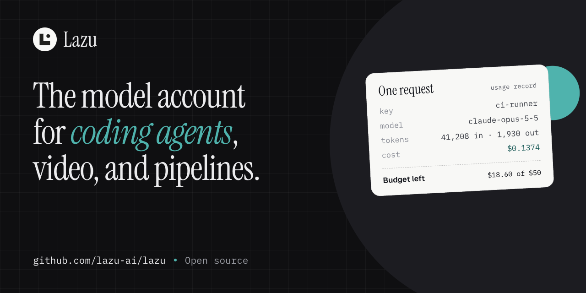
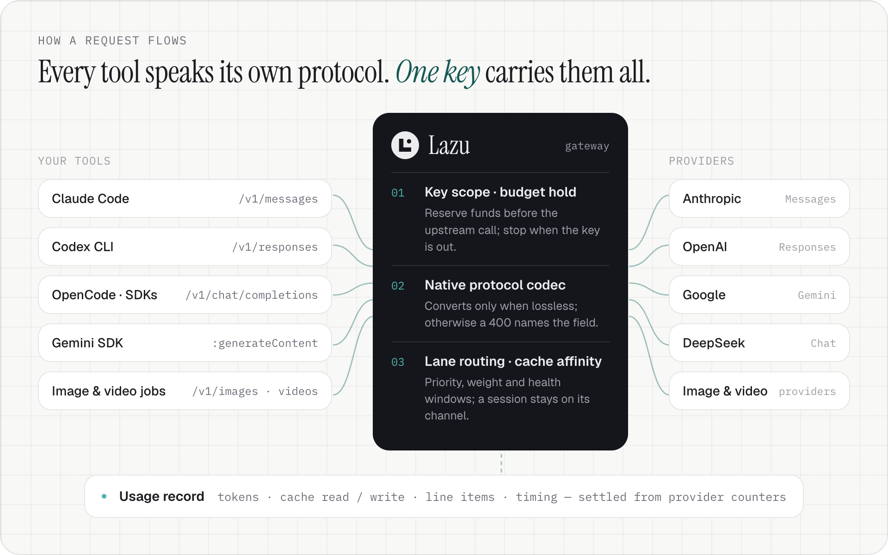
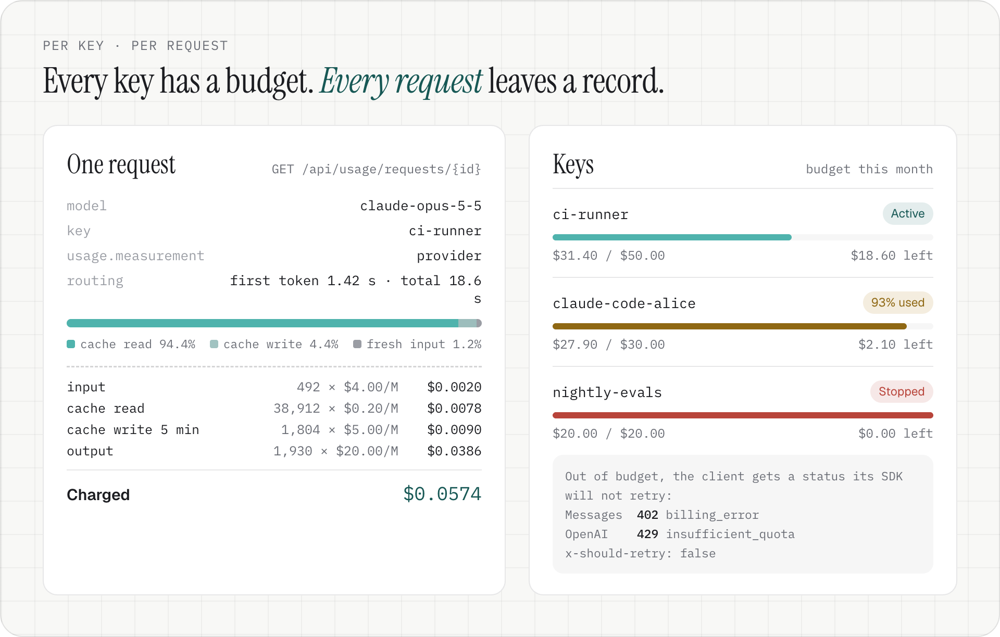
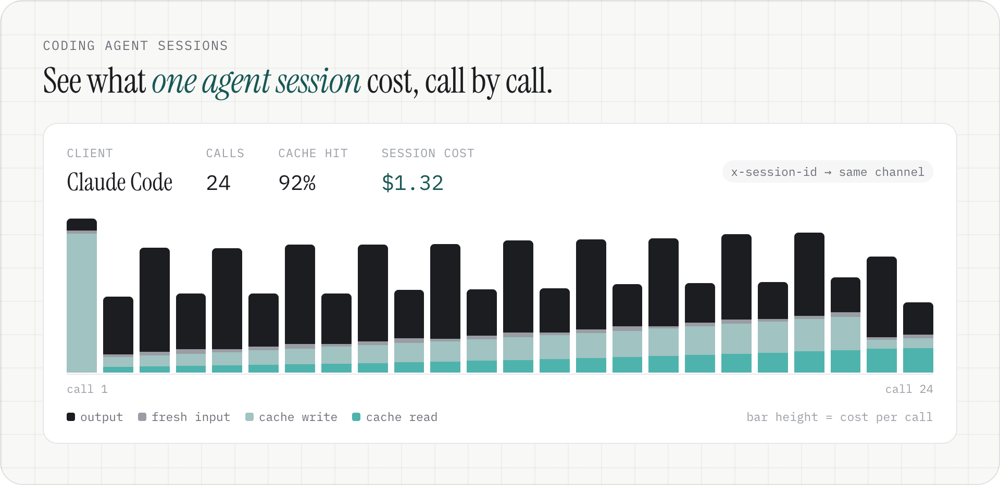

<!-- README.md and README.zh-CN.md carry the same content; change both in one PR. -->

<p align="center">
  <a href="https://lazu.ai">
    
  </a>
</p>

<p align="center">
  <a href="https://lazu.ai"><strong>lazu.ai</strong></a> ·
  <a href="https://lazu.ai/docs">Docs</a> ·
  <a href="https://lazu.ai/docs/integrations/overview">Integrations</a> ·
  <a href="https://lazu.ai/docs/compare/overview">Compare</a> ·
  <a href="./LICENSE">AGPL-3.0</a> ·
  <a href="./README.zh-CN.md">简体中文</a>
</p>

Lazu is an open-source model gateway with an account and a ledger built in. One API key reaches Claude, GPT, Gemini and DeepSeek over their own native APIs, plus image and video generation. Every key carries its own budget, and every request leaves a usage record you can read back.

Use the hosted service at [lazu.ai](https://lazu.ai), or run the same code yourself.

| | Hosted — [lazu.ai](https://lazu.ai) | Self-hosted — this repository |
| --- | --- | --- |
| Models | Provided, pay as you go | Bring your own upstream accounts |
| Start | Sign up, create a key | `docker compose up` ([Quick start](#quick-start-docker)) |
| Claude Code base URL | `ANTHROPIC_BASE_URL=https://api.lazu.ai` | `ANTHROPIC_BASE_URL=http://localhost:3001` |

## How it works

<picture>
  <source media="(prefers-color-scheme: dark)" srcset="./brand/assets/readme/flow-en-dark.png" />
  
</picture>

## What Lazu does

- **One endpoint, four native protocols.** OpenAI Chat Completions and Responses, Anthropic Messages, and Gemini `generateContent` are served natively. Cross-protocol conversion happens only when lossless; otherwise Lazu rejects with a `400` naming the unsupported feature instead of quietly dropping parameters ([design](./docs/protocol-conversion-architecture.md)).
- **Accounts, keys, and hard budgets.** Users, teams, and projects; per-key and per-member budgets; lanes chosen per key and per model. Funds are reserved before the upstream call and settled strictly from provider usage counters ([billing contract](./docs/billing-contract.md)).
- **A usage record per request.** Each completed request records normalized token & prompt-cache dimensions, the source of every number (provider, local estimate, or unavailable), billing line items, and public timing — readable by the key that made it ([request details](https://lazu.ai/docs/endpoints/usage-requests)). Coding agent calls group into sessions, with an offline reconciliation script ([`summarize-agent-session.py`](./ops/scripts/summarize-agent-session.py)).
- **Images, video and speech on the same key.** `/v1/images/generations`, asynchronous `/v1/videos` jobs and audio endpoints, billed into the same ledger ([media API](https://lazu.ai/docs/endpoints/media)).
- **Visible routing and failover.** Several upstream channels per model picked by priority and weight, automatic health windows, and session affinity (`x-session-id`) to preserve prompt caches.
- **Extension points instead of forks.** Deployments compile custom features through the generic hooks in [docs/EXTENSIONS.md](./docs/EXTENSIONS.md); the core stays standalone.

<picture>
  <source media="(prefers-color-scheme: dark)" srcset="./brand/assets/readme/ledger-en-dark.png" />
  
</picture>

<picture>
  <source media="(prefers-color-scheme: dark)" srcset="./brand/assets/readme/session-en-dark.png" />
  
</picture>

### How it differs from a thin proxy

| Failure mode | Thin proxy | Lazu |
| --- | --- | --- |
| Unsupported parameter across protocols | Silently dropped | Explicit `400` naming the field |
| Budget or balance exhausted mid-session | Client retries in a loop | A final status the SDK will not retry (`402` on Messages, `429` on OpenAI, with `x-should-retry: false`) |
| Cost & prompt-cache visibility | Opaque balance deduction | Per-call usage record & billing line items |
| Client model discovery | Hardcoded model lists | Public, unauthenticated `GET /v1/models` |

## Ecosystem & integrations

### Built-in provider presets

| Project | How to use | Guide |
| --- | --- | --- |
| **[cc-connect](https://github.com/chenhg5/cc-connect)** | Built-in provider preset for Claude Code, Codex (`wire_api: "responses"`), and OpenCode via `cc-connect provider presets` | [cc-connect guide](https://lazu.ai/docs/integrations/cc-connect) |

### First-class coding agents & clients

| Client | Protocol | Guide |
| --- | --- | --- |
| **Claude Code** | Native Anthropic Messages (`https://api.lazu.ai`) | [Claude Code guide](https://lazu.ai/docs/integrations/claude-code) |
| **Codex CLI** | Native OpenAI Responses (`wire_api = "responses"`) | [Codex CLI guide](https://lazu.ai/docs/integrations/codex) |
| **OpenCode** | OpenAI-compatible (`https://api.lazu.ai/v1`) | [OpenCode guide](https://lazu.ai/docs/integrations/opencode) |
| **Goose** | Provider-maintained custom provider JSON | [Goose guide](https://lazu.ai/docs/integrations/goose) |
| **Cursor, Cline, Cherry Studio, Chatbox, SDKs** | OpenAI-compatible + public `GET /v1/models` | [All integrations](https://lazu.ai/docs/integrations/overview) |

> **Building a client or model catalog?** `GET https://api.lazu.ai/v1/models` and `GET https://lazu.ai/api/pricing` are public (no API key required) for live model and capability discovery.

## Quick start (Docker)

```bash
cp .env.example .env        # set ROOT_PASSWORD and the database passwords
docker compose --env-file .env -f platform/docker/docker-compose.yml up --build -d
```

Open <http://localhost:3000> and sign in with `ROOT_USERNAME` / `ROOT_PASSWORD` (`root` / `change-me-local-root` if you left them empty). Add an upstream under **Model operations**, create an API key, and call `http://localhost:3001/v1/chat/completions`:

```bash
curl http://localhost:3001/v1/chat/completions \
  -H "Authorization: Bearer $LAZU_API_KEY" \
  -H "Content-Type: application/json" \
  -d '{"model":"<a model id from your catalog>","messages":[{"role":"user","content":"Hello"}]}'
```

The stack runs the gateway (`3001`), background jobs, web console (`3000`), separate Core and Telemetry PostgreSQL stores, and Redis. For optional integrations (mail, card top-ups, R2 file storage) and production checklists, see [docs/DEPLOYMENT.md](./docs/DEPLOYMENT.md).

---

<details>
<summary><strong>Maintainer &amp; Local Development Guide</strong> — Workspace, <code>./run.sh</code>, Docs, Config, Security &amp; Contributing</summary>

### Workspace

| Path | Purpose |
| --- | --- |
| `apps/api/` | API server entrypoint |
| `apps/web/` | Web console and public pages |
| `apps/docs/` | Vocs documentation site (`en` / `zh` / `zh-TW` / `ja`) |
| `apps/worker/` | Background jobs |
| `internal/` | Backend controllers, services, models, relay adapters, protocol codecs, middleware, settings |
| `packages/` | Shared contracts and pure domain rules |
| `config/` | Backend config, env templates, seed data |
| `ops/` | Operational scripts and deployment helpers |
| `docs/` | Maintainer notes: contracts, architecture, deployment, glossary |
| `brand/` | Visual and product design reference |
| `.local-results/` | Local only, git-ignored: Playwright screenshots, traces, reports and build output; see [CONTRIBUTING.md](./CONTRIBUTING.md#本地产物local-artifacts) |

Shared contract source: `packages/contracts/openapi/lazu-api-reference.v1.yaml`. Error codes and envelopes are documented in [docs/ERRORS.md](./docs/ERRORS.md).

### Optional Docker integrations

Everything beyond the gateway stays off until configured (`platform/docker/docker-compose.integrations.example.yml`):

| Feature | Configure |
| --- | --- |
| Mail (sign-up codes, receipts, alerts) | `RESEND_API_KEY` and `ADMIN_EMAIL`, or `smtp` in `config/backend/config.yaml` |
| Card top-ups | `STRIPE_SECRET_KEY`, `STRIPE_WEBHOOK_SECRET`, `STRIPE_PRICE_ID` |
| Files API and request captures | `R2_ENDPOINT`, `R2_BUCKET`, `R2_ACCESS_KEY_ID`, `R2_SECRET_ACCESS_KEY` |
| Links in mail and payments | `FRONTEND_BASE_URL`, and `site` in `config/backend/config.yaml` |
| Probes against client-restricted upstreams | `probe_identities` in `config/backend/config.yaml` |

### Local development

```bash
./run.sh        # fast start using existing dependencies/caches
./rebuild.sh    # clean dependency/cache rebuild + start
make help       # other repository commands
```

Local ports: PostgreSQL `127.0.0.1:10000`, Redis `127.0.0.1:10001`, API `3000`, web `5173`, docs `3002`.

Docker stack helper: `./ops/scripts/stack.sh up --build`.

### Docs

Public docs source lives in `apps/docs/` (Vocs). Start with [docs/README.md](./docs/README.md) for current contracts and operations.

```bash
cd apps/docs && npm install && npm run dev -- --port 3002
```

Canonical docs path: `https://lazu.ai/docs`.

### Config

Backend config resolution order: `APP_CONFIG_FILE` → `config/backend/config.yaml` → `config/backend/config.yml` → `/app/config/backend/config.yaml` → `/app/config/backend/config.yml`.

### Security

- Do not commit real config secrets; keep `config/backend/config.yaml` local or environment-provided.
- Production deployments must use strong `SESSION_SECRET` and `CRYPTO_SECRET` values.
- See [SECURITY.md](./SECURITY.md) to report a vulnerability privately.

### Contributing

See [CONTRIBUTING.md](./CONTRIBUTING.md) and [CODE_OF_CONDUCT.md](./CODE_OF_CONDUCT.md).

</details>
