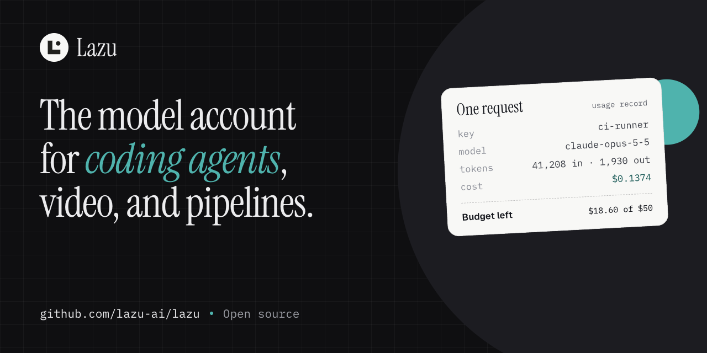
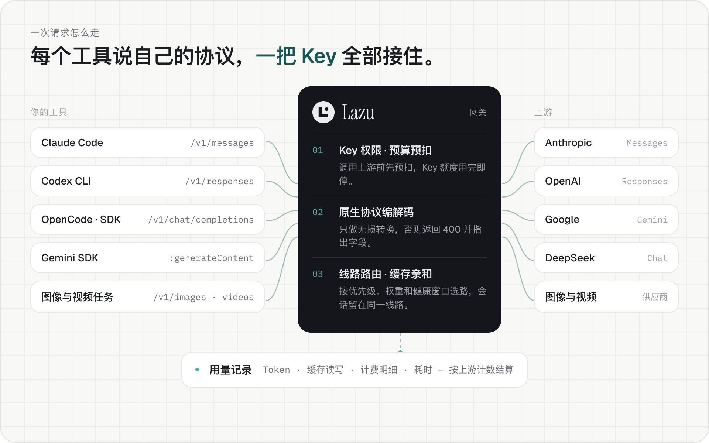
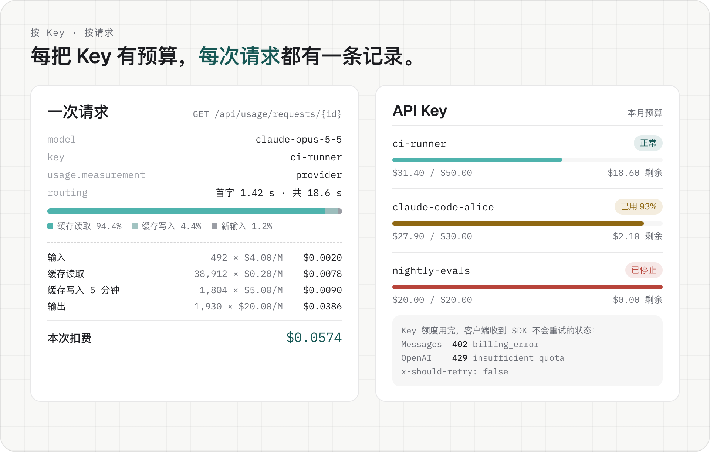
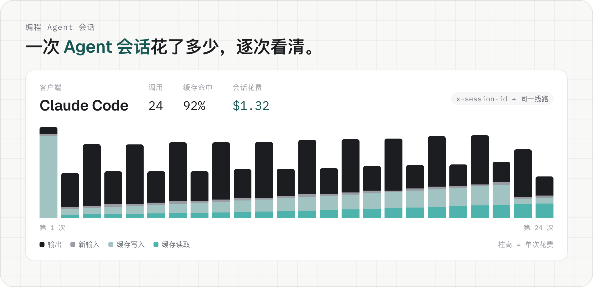

<!-- README.md 与 README.zh-CN.md 内容一致，改动请在同一个 PR 里同步两份。 -->

<p align="center">
  <a href="https://lazu.ai">
    
  </a>
</p>

<p align="center">
  <a href="https://lazu.ai"><strong>lazu.ai</strong></a> ·
  <a href="https://lazu.ai/docs/zh">文档</a> ·
  <a href="https://lazu.ai/docs/zh/integrations/overview">接入指南</a> ·
  <a href="https://lazu.ai/docs/zh/compare/overview">网关对比</a> ·
  <a href="./LICENSE">AGPL-3.0</a> ·
  <a href="./README.md">English</a>
</p>

Lazu 是一个自带账户和账本的开源模型网关。一个 API Key 通过各家原生协议调用 Claude、GPT、Gemini 和 DeepSeek，也能生成图像和视频。每把 Key 有自己的预算，每次请求都留下一条可以查回的用量记录。

可以直接用托管版 [lazu.ai](https://lazu.ai)，也可以用这份代码自己部署。

| | 托管版 — [lazu.ai](https://lazu.ai) | 自托管 — 本仓库 |
| --- | --- | --- |
| 模型 | 平台提供，按量付费 | 接入你自己的上游账号 |
| 开始 | 注册后创建 Key | `docker compose up`（见[快速自托管](#快速自托管docker)） |
| Claude Code 地址 | `ANTHROPIC_BASE_URL=https://api.lazu.ai` | `ANTHROPIC_BASE_URL=http://localhost:3001` |

## 工作方式

<picture>
  <source media="(prefers-color-scheme: dark)" srcset="./brand/assets/readme/flow-zh-dark.png" />
  
</picture>

## 核心能力

- **一个入口，四种原生协议。** 原生提供 OpenAI Chat Completions / Responses、Anthropic Messages 与 Gemini `generateContent`。跨协议仅在无损前提下桥接，不兼容字段明确返回 `400` 指出原因，绝不静默丢弃参数（[协议架构](./docs/protocol-conversion-architecture.md)）。
- **账户、Key 与硬预算。** 支持用户、团队、项目与按 Key 预算上限；请求前预扣、结束后严格按上游真实计数结算（[计费契约](./docs/billing-contract.md)）。
- **每笔请求可读账单。** 记录归一化 Token 与 Prompt Cache 维度、计费明细行与耗时，Key 所有者可按请求 ID 随时查回（[请求详情](https://lazu.ai/docs/zh/endpoints/usage-requests)）；编程 Agent 会话自动归组，支持离线脚本对账（[`summarize-agent-session.py`](./ops/scripts/summarize-agent-session.py)）。
- **图像、视频与语音同一把 Key。** `/v1/images/generations`、异步 `/v1/videos` 任务与音频接口，计入同一本账（[媒体接口](https://lazu.ai/docs/zh/endpoints/media)）。
- **可见路由与自动容灾。** 同一模型可挂多条上游线路，按优先级和权重调度，异常线路自动进入健康观察窗，并通过 `x-session-id` 保持多轮会话 Prompt Cache 命中。
- **扩展点而非 Fork。** 商业或定制部署通过 [docs/EXTENSIONS.md](./docs/EXTENSIONS.md) 的通用钩子编入，核心仓库保持独立可运行。

<picture>
  <source media="(prefers-color-scheme: dark)" srcset="./brand/assets/readme/ledger-zh-dark.png" />
  
</picture>

<picture>
  <source media="(prefers-color-scheme: dark)" srcset="./brand/assets/readme/session-zh-dark.png" />
  
</picture>

### 与普通薄代理的区别

| 常见痛点 | 普通薄代理 | Lazu |
| --- | --- | --- |
| 跨协议参数不兼容 | 静默丢弃 | 明确返回 `400` 指明不支持字段 |
| 余额或预算耗尽 | 客户端死循环重试 | 返回 SDK 不会重试的终止状态（Messages 为 `402`，OpenAI 为 `429`，并带 `x-should-retry: false`） |
| 计费与缓存命中 | 黑盒扣额度 | 单次调用可查 Token / Cache 明细与账单行 |
| 客户端模型发现 | 手动抄写模型名 | 免 Key 公开 `GET /v1/models` 自动发现 |

## 生态与客户端接入

### 内置供应商预设

| 项目 | 使用方式 | 接入指南 |
| --- | --- | --- |
| **[cc-connect](https://github.com/chenhg5/cc-connect)** | 已内置 Lazu 预设（覆盖 Claude Code、Codex `wire_api: "responses"`、OpenCode），运行 `cc-connect provider presets` 即可选用 | [cc-connect 指南](https://lazu.ai/docs/zh/integrations/cc-connect) |

### 主流编程 Agent 与客户端

| 客户端 | 协议 | 接入指南 |
| --- | --- | --- |
| **Claude Code** | 原生 Anthropic Messages（`https://api.lazu.ai`） | [Claude Code 指南](https://lazu.ai/docs/zh/integrations/claude-code) |
| **Codex CLI** | 原生 OpenAI Responses（`wire_api = "responses"`） | [Codex CLI 指南](https://lazu.ai/docs/zh/integrations/codex) |
| **OpenCode** | OpenAI 兼容（`https://api.lazu.ai/v1`） | [OpenCode 指南](https://lazu.ai/docs/zh/integrations/opencode) |
| **Goose** | 自定义 Provider JSON | [Goose 指南](https://lazu.ai/docs/zh/integrations/goose) |
| **Cursor、Cline、Cherry Studio、Chatbox、SDK** | OpenAI 兼容 + 公开 `GET /v1/models` | [接入总览](https://lazu.ai/docs/zh/integrations/overview) |

> **客户端或模型目录维护者**：`GET https://api.lazu.ai/v1/models` 与 `GET https://lazu.ai/api/pricing` 均公开免 Key，可直接用于实时模型与能力发现。

## 快速自托管（Docker）

```bash
cp .env.example .env        # 设置 ROOT_PASSWORD 与数据库密码
docker compose --env-file .env -f platform/docker/docker-compose.yml up --build -d
```

打开 <http://localhost:3000>，使用 `ROOT_USERNAME` / `ROOT_PASSWORD`（默认 `root` / `change-me-local-root`）登录。在 **模型运营** 添加上游渠道、创建 API Key 后，即可请求 `http://localhost:3001/v1/chat/completions`：

```bash
curl http://localhost:3001/v1/chat/completions \
  -H "Authorization: Bearer $LAZU_API_KEY" \
  -H "Content-Type: application/json" \
  -d '{"model":"<目录中的模型 ID>","messages":[{"role":"user","content":"Hello"}]}'
```

完整部署清单与可选集成（邮件、支付、R2 存储）见 [docs/DEPLOYMENT.md](./docs/DEPLOYMENT.md)。

---

<details>
<summary><strong>开发者与本地调试说明</strong> — 仓库目录、<code>./run.sh</code>、文档构建与安全规范</summary>

- **快速启动**：`./run.sh`（复用现有依赖与缓存）；干净重建：`./rebuild.sh`；其他命令：`make help`。
- **本地端口**：PostgreSQL `127.0.0.1:10000`、Redis `127.0.0.1:10001`、API `3000`、Web `5173`、Docs `3002`。
- **文档开发**：`cd apps/docs && npm install && npm run dev -- --port 3002`。
- **完整维护者说明**：仓库目录、Docker 可选集成与配置加载顺序见[英文 README](./README.md#maintainer--local-development-guide) 的折叠段。
- **安全与贡献**：请勿提交真实密钥；漏洞反馈见 [SECURITY.md](./SECURITY.md)，贡献规范见 [CONTRIBUTING.md](./CONTRIBUTING.md)。

</details>
